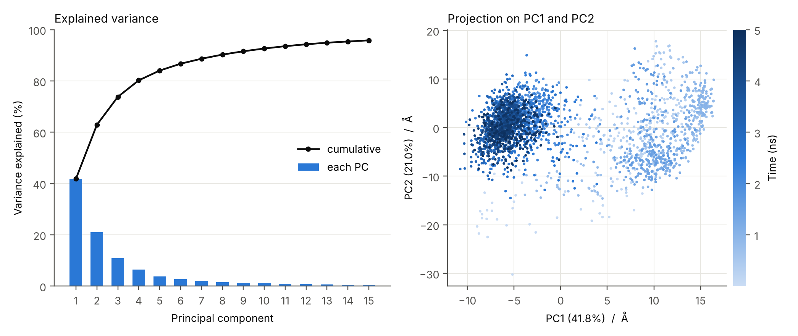
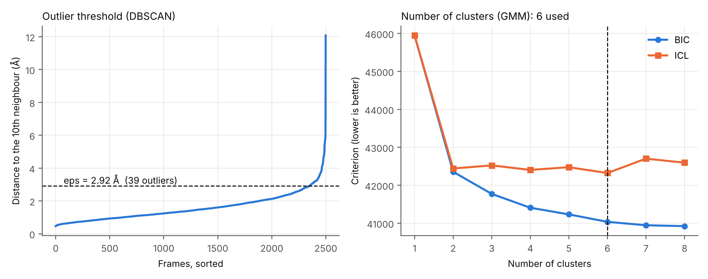
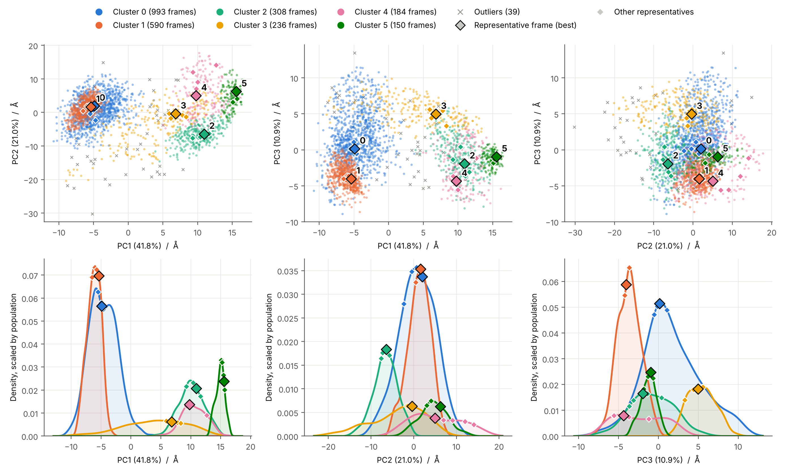
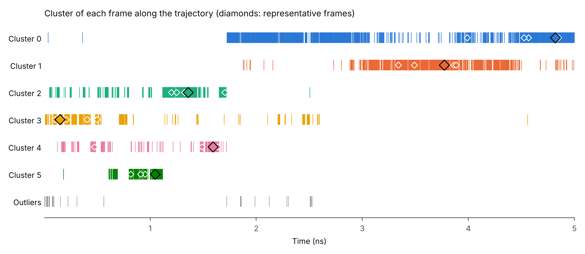

<p align="justify"><b>This page clusters the frames of a molecular dynamics trajectory on the principal components of an atom selection of your choice, and picks the frames that best represent each cluster. Everything runs in Python with MDAnalysis and scikit-learn: no GROMACS tools are needed, and any trajectory format that MDAnalysis reads can be used.</b></p>

<p align="justify">The workflow has three steps, one script each. <a href="traj_pca.py" target="_blank">traj_pca.py</a> reads the trajectory, makes the molecules whole across the periodic boundaries, fits every frame on a selection and runs a principal component analysis (PCA) on the Cartesian coordinates of the atoms you want to analyse. <a href="pca_dbscan_gmm.py" target="_blank">pca_dbscan_gmm.py</a> flags outliers with DBSCAN, clusters the remaining frames with a Gaussian mixture model (GMM) on the first PCs and chooses the representative frames of each cluster. <a href="extract_frames.py" target="_blank">extract_frames.py</a> writes those frames to structure files.</p>

<p align="justify">The example files in the <a href="https://github.com/arvpinto/3D_clustering_PCA/tree/main/example" target="_blank">example</a> folder let you run every command on this page as written: a 5 ns implicit-solvent simulation of the 10-residue peptide CLN025 (chignolin), started from an extended chain and saved every 2 ps (2500 frames). In such a short run the peptide does not reach its folded hairpin, but it goes through extended, partly collapsed and compact states, which is what the clustering needs to show.</p>

---

<br>
<h2> <p align="center"> <b>I - PCA of the trajectory on a chosen selection</b> </p></h2>

<br/>

Install the Python packages (Python 3.9 or newer):

```
pip install MDAnalysis scikit-learn scipy matplotlib plotly
```

<br/>

**Choosing the selection.** The PCA runs on the atoms given with `--select`, written in the <a href="https://userguide.mdanalysis.org/stable/selections.html" target="_blank">MDAnalysis selection language</a>. The frames are fitted (rotation and translation) on the atoms given with `--fit-select`, which are the same atoms unless you say otherwise. Fitting on a stable part of the protein and analysing a flexible one keeps the motion of the flexible part in the PCA, instead of fitting it away. Some examples:

| What to analyse | `--select` | `--fit-select` |
|---|---|---|
| Whole backbone | `"backbone"` | (same) |
| Backbone around the active site | `"backbone and (resid 160 185 237 or (same residue as around 10 (resid 160 185 237)))"` | (same) |
| A loop, seen from the rest of the protein | `"backbone and resid 45:60"` | `"name CA and not resid 45:60"` |
| A ligand and its pocket | `"(resname LIG and not name H*) or (name CA and same residue as around 8 resname LIG)"` | `"name CA"` |
| One domain of the first chain (segment) | `"name CA and segindex 0 and resid 1:120"` | `"name CA"` |

<p align="justify">Selections that depend on distances, like <code>around</code>, are evaluated once, on the first frame of the trajectory, so the same atoms are used in every frame. Check a selection before running the analysis: with <code>--check-selection</code> the script prints the number of atoms and residues it found, writes them to a pdb file that you can open in VMD or PyMOL, and stops.</p>

```
python traj_pca.py -s cln025.pdb -f cln025.xtc --select "backbone and resid 3:8" --fit-select "name CA" --check-selection
```

<br/>

<p align="justify"><b>Periodic boundaries.</b> There is no need to correct the trajectory with <code>gmx trjconv</code> beforehand. When the trajectory has a box, every molecule that holds selected atoms is made whole along its bonds in every frame, and molecules that belong together (a complex, a dimer, a bound ligand) are kept on the same side of the box. This works with any box shape, including truncated octahedra. The bonds are read from the topology when it has them (a GROMACS tpr, a psf, an Amber prmtop) and guessed from the distances otherwise (gro or pdb files), so a tpr file is the safest choice for GROMACS trajectories. If the selected atoms still jump in size between frames, the script prints a warning.</p>

<br/>

Run the PCA on the backbone of the example peptide:

```
python traj_pca.py -s cln025.pdb -f cln025.xtc --select "backbone" --modes 2 -o pca
```

```
Selections
  PCA:           "backbone"
                 40 atoms in 10 residues (TYR1 to TYR10)
  fit:           "backbone"
                 40 atoms in 10 residues (TYR1 to TYR10)
Periodic boundaries: none
Reading 2500 frames (0 to 2499, every 1)
Fit on the average structure (converged in 6 iterations)
  RMSD of the fit atoms to the reference: mean 1.79 A, max 5.55 A
PCA on 40 atoms (120 coordinates)
  PC   variance (A^2)   explained   cumulative
  1          59.522       41.8%       41.8%
  2          29.927       21.0%       62.9%
  3          15.512       10.9%       73.8%
  32 PCs kept in the npz file (99.1% of the variance)
```

<p align="justify">The frames are fitted on the average structure, which is found iteratively, so the result does not depend on which frame happens to come first (<code>--ref first</code> fits on the first frame instead). The first three PCs hold 74% of the variance here. Besides those, the npz file keeps every PC needed to reach 99% of the variance: they are used in the next step to compare whole structures, not only their first three coordinates. With <code>--modes 2</code> the motion along PC1 and PC2 is written to <code>pca_pc1.pdb</code> and <code>pca_pc2.pdb</code>, which play as movies in VMD or PyMOL.</p>

<div align="center">
    
</div>

Other options of `traj_pca.py`:

| Option | Meaning |
|---|---|
| `-f a.xtc b.xtc` | Several trajectory files, read one after the other |
| `-b`, `-e`, `-dt` | First frame, last frame (exclusive) and stride; the frame numbers kept in the outputs are always those of the full trajectory |
| `--pbc none` | Read the coordinates as they are (for trajectories already made whole) |
| `--n-pcs`, `--keep-variance` | PCs listed and written to the csv file; variance kept in the npz file |
| `--dpi`, `--no-show` | Resolution of the saved figure (600 by default) and whether to open it |

<p align="justify">The coordinates of the selection are held in memory: 10 000 frames of 1000 atoms take about 120 MB. For very long trajectories, use <code>-dt</code>.</p>

<br>
<h2> <p align="center"> <b>II - Clustering and representative frames</b> </p></h2>

<br/>

Run the clustering on the npz file. With no other options, the DBSCAN threshold and the number of clusters are estimated from the data:

```
python pca_dbscan_gmm.py -i pca.npz -o cluster
```

```
Clustering on the first 3 PCs (73.8% of the variance); structures compared with 32 PCs (99.1%)
DBSCAN: eps 2.917 A (knee of the k-distance curve), min_samples 10: 39 outliers (1.6% of the frames)
GMM: scanning 1 to 8 clusters
  clusters        BIC          ICL
         1      45949.5      45949.5
         2      42354.4      42442.3
         3      41772.8      42523.6
         4      41407.9      42405.2
         5      41232.1      42475.7
         6      41035.8      42322.2
         7      40945.7      42702.3
         8      40922.8      42595.0
GMM: 6 clusters (lowest ICL)
Representative frames: medoid of the densest 10% of each cluster (RMSD over 32 PCs), at least 10 frames apart
  cluster  frames      %   mean prob.  mean RMSD (A)   representative frames (best first)
        0     993   39.7         0.94           1.39   2409 2282 2424 1994 2262
        1     590   23.6         0.85           0.84   1886 1669 1744 1930 1941
        2     308   12.3         0.82           1.30   678 598 624 851 660
        3     236    9.4         0.87           1.88   73 49 104 201 247
        4     184    7.4         0.90           1.56   795 742 817 806 236
        5     150    6.0         0.91           0.92   522 407 512 474 453
```

<p align="justify"><b>Outliers.</b> DBSCAN marks as outliers the frames that have fewer than <code>--min-samples</code> neighbours within a distance <code>--eps</code> (in Å, in the space of the PCs used for clustering). These are frames in sparsely visited regions, usually transitions, which would otherwise pull the clusters towards them. By default <code>eps</code> is the knee of the curve of distances to the 10th neighbour (left panel below): the point where the curve starts to rise steeply. A few percent of outliers is typical; if the number looks wrong, give <code>--eps</code> a value read from the curve.</p>

<p align="justify"><b>Number of clusters.</b> The GMM fits each cluster with a Gaussian of its own shape and orientation, so clusters do not need to be spherical or of the same size. The script fits 1 to <code>--max-clusters</code> clusters and takes the lowest ICL (integrated completed likelihood). The ICL is the BIC plus a penalty for clusters that overlap, so it prefers well-separated clusters, while the BIC alone keeps decreasing as clusters are added (right panel). When the ICL curve is flat, as from 2 to 6 clusters here, several numbers fit the data almost equally well: look at the plots below and at the representative structures, and fix the number with <code>--n-clusters</code>. Every frame also gets the probability of belonging to its cluster; frames with low values lie between clusters.</p>

<div align="center">
    
</div>

<br/>

<p align="justify">The interactive plot shows every frame in the space of the first three PCs. Point size grows with the local density of the frame, diamonds mark the representative frames (the largest is the best one of each cluster), and hovering over a point shows its frame number, time and cluster probability. Clicking a cluster in the legend hides it.</p>

<div style="display: flex; justify-content: center; align-items: center; height: 100vh;">
    <iframe src="assets/plots/cluster_3d.html" width="1904" height="894" title="Interactive 3D plot of the frames on PC1, PC2 and PC3, coloured by cluster"></iframe>
</div>

<br/>

<p align="justify">The same clusters on each pair of PCs (top), and the density of each cluster along each PC, scaled by its population (bottom). The curves show whether a cluster has a single, well-defined maximum, and whether its representative frames sit near it.</p>

<div align="center">
    
</div>

<p align="justify">Along the trajectory, the extended and partly collapsed states (clusters 2 to 5) are visited in the first 2 ns, and the compact states of clusters 0 and 1 take over afterwards (a helical turn at residues 6 to 8 is present in 84% of the frames of cluster 1 and 39% of cluster 0, and in almost none of the others). A cluster visited in a single stretch of time, rather than repeatedly, may not be converged in a short simulation.</p>

<div align="center">
    
</div>

<br/>

<p align="justify"><b>How the representative frames are chosen.</b> A good representative is a real frame that sits where the cluster is most populated and looks like the rest of the cluster as a whole. The script finds it in three steps:</p>

- <p align="justify">Every frame of a cluster is compared with the others through their RMSD over the whole selection. Because all frames were fitted on the same reference, this RMSD is the distance between their projections on all the PCs kept (32 here, 99% of the variance) divided by the square root of the number of atoms. Using all the PCs means that two frames close on PC1 to PC3 but different elsewhere are not mistaken for each other. For this example it agrees with the RMSD after superposing each pair of frames (correlation 1.000).</p>
- <p align="justify">The local density of each frame is measured as its mean RMSD to its nearest neighbours in the cluster (as many as 10% of the cluster). No kernel bandwidth has to be chosen, so the measure does not depend on the units or spread of the PCs. The densest 10% of the frames form the core of the cluster (<code>--core-fraction</code>).</p>
- <p align="justify">The core frames are ranked by their mean RMSD to all the frames of the cluster, so the first representative is the medoid of the core. The next ones follow in the same order, at least <code>--min-sep</code> frames apart, so that they are not consecutive, nearly identical snapshots.</p>

<p align="justify">The previous version of this page took the point of highest kernel density in the first three PCs, with a fixed bandwidth, and the frames closest to it. The table compares both choices for the six clusters of the example, using the RMSD after superposing each pair of frames and averaging over the clusters by population. The best possible value of each measure was found by trying every frame of every cluster.</p>

| Best representative chosen by | Frames of the cluster within 1 Å RMSD | Mean RMSD to the cluster (Å) | Mean RMSD to the nearest 10% (Å) |
|---|---|---|---|
| Kernel density peak on 3 PCs (previous version) | 27.7% | 1.38 | 0.80 |
| Medoid of the densest 10%, all PCs (this version) | 33.4% | 1.29 | 0.69 |
| Best possible frame for each measure | 34.8% | 1.28 | 0.62 |

<p align="justify">For clusters larger than 5000 frames, the RMSDs are computed against a random subset of 5000 frames of the cluster (<code>--max-ref</code>), which keeps the time and memory needed in check for long trajectories.</p>

<br/>

Output files of `pca_dbscan_gmm.py`:

| File | Content |
|---|---|
| `cluster_assignments.csv` | Cluster of every frame (outliers are -1), its probability, density rank, RMSDs and PC coordinates |
| `cluster_representatives.csv` | Representative frames of each cluster, best first (input of the next step) |
| `cluster_3d.html` | Interactive plot (add `--plotly-js embed` for a file that works offline) |
| `cluster_overview.png`, `cluster_timeline.png`, `cluster_parameters.png` | The figures above, at 600 dpi by default |

Other options: `--dims` (number of PCs used for clustering, 3 by default), `--covariance` (shape of the Gaussians), `--n-rep` (representatives per cluster), `--seed` (the results are reproducible for a given seed). Run any script with `-h` to see all its options.

<br>
<h2> <p align="center"> <b>III - Frame extraction</b> </p></h2>

<br/>

Write the best representative of each cluster to a pdb file:

```
python extract_frames.py -s cln025.pdb -f cln025.xtc -r cluster_representatives.csv --max-rank 1 --format pdb
```

```
Files written
  rep_c3_r1_f73.pdb   (frame 73, time 148.0 ps)
  rep_c5_r1_f522.pdb   (frame 522, time 1046.0 ps)
  rep_c2_r1_f678.pdb   (frame 678, time 1358.0 ps)
  rep_c4_r1_f795.pdb   (frame 795, time 1592.0 ps)
  rep_c1_r1_f1886.pdb   (frame 1886, time 3774.0 ps)
  rep_c0_r1_f2409.pdb   (frame 2409, time 4820.0 ps)
```

<p align="justify">The file names give the cluster, the rank of the frame within the cluster and the frame number. Frame numbers start at 0 and count the frames of the trajectory as it was read by <code>traj_pca.py</code>, so give the same trajectory file or files, in the same order. Without <code>--max-rank</code> all the representatives are written; <code>--clusters 0 2</code> limits the extraction to some clusters, and <code>--frames 120 1840</code> extracts any other frames.</p>

<p align="justify">By default the whole system is written (<code>--select "all"</code>). For trajectories with a box, the solute (<code>--solute</code>, the protein by default) is made whole and centred, and the solvent and ions are wrapped around it, so the structures can be used directly as starting points for QM/MM, docking or new simulations. With a tpr topology the water molecules are kept whole; with a gro or pdb file their atoms are wrapped one by one. Use <code>--select "protein"</code> to write the protein only, or <code>--solute "protein or resname LIG"</code> to keep a ligand with the protein.</p>
